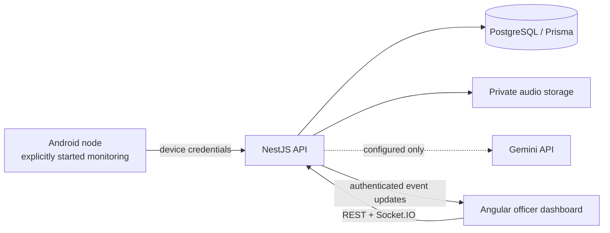

# ForestGuard AI 2.0

ForestGuard is a smartphone-based forest monitoring platform foundation. Authorized officers can review possible suspicious sound events in a web dashboard. An AI classification is advisory and never establishes illegal logging. Human review is required.

## Current delivery

This repository provides a NestJS API, PostgreSQL/Prisma data model, Angular monitoring dashboard, Android Compose monitoring node, and local Docker environment. The backend supports authenticated devices, heartbeat history and stale-device detection, filtered event review, private audio evidence, alert acknowledgement, and optional Gemini processing. The Android foundation reports device health and GPS while explicitly monitoring; audio capture and event submission from Android are not implemented. This is not a field-validated detection system; no detection accuracy is claimed.

## Architecture

## Repository layout

- `backend/` NestJS API, Prisma schema and seed
- `frontend/` Angular application shell
- `mobile/` Android/Kotlin Compose monitoring node
- `docs/` setup, API, AI and limitations
- `docker-compose.yml` PostgreSQL, API and web services

## Requirements

Node.js 20+, npm, Docker Desktop (or local PostgreSQL), and Android Studio with Android SDK 35 and JDK 17 for the mobile app. The committed Compose setup runs PostgreSQL, API, and frontend. Gemini is optional.

## Quick start

1. Copy `.env.example` to `.env` and replace the development secrets.
2. Run `docker compose up --build`.
3. Run `docker compose exec backend npx prisma db seed` to add labelled demo records.
4. Visit `http://localhost:4200` (dashboard shell) and `http://localhost:3000/api/docs` (Swagger).
5. Open `mobile/` in Android Studio. For an emulator, the default API host is `10.0.2.2`; for a physical phone, configure a reachable HTTPS backend URL in the app.

For local API work: `cd backend; npm install; npx prisma generate; npx prisma db push; npm run seed; npm run start:dev`.
For local web work: `cd frontend; npm install; npm start`.

The included seed creates a clearly labelled demo officer/admin and demo records; credentials are `admin@forestguard.demo` / `DemoAdmin!ChangeMe` and `officer@forestguard.demo` / `DemoOfficer!ChangeMe`. Change or remove demo credentials before deployment. Seed is opt-in and does not run automatically in production.

## API and security

See [API documentation](docs/api-documentation.md). Human routes use JWT bearer authentication and role metadata; device calls use their separate device credential. Device audio uploads use `POST /api/events/:eventId/audio`; officers can listen through the authenticated `GET /api/events/:eventId/audio` route. Configure `JWT_SECRET`, database credentials, and CORS before exposure. API docs are available at `/api/docs`.

## AI

Gemini analysis runs only when `AI_PROVIDER=gemini`, `GEMINI_API_KEY`, and `GEMINI_MODEL` are set on the backend. The model name comes from configuration, not the source code. `AI_PROVIDER=mock` enables a deterministic `UNKNOWN` response marked `DEMO ONLY`; `disabled` is the default. Processing is asynchronous; failures preserve the event and evidence. AI output is advisory, may omit confidence, and always requires human review. See [AI integration](docs/ai-integration.md).

## Known limitations

- The Android monitoring milestone supports administrator-provisioned device pairing, Keystore-encrypted credentials, explicit location/notification permissions, foreground GPS/heartbeat operation, Room-backed offline heartbeat/location queues, and WorkManager retry. It does not record microphone audio or create events yet. See [Android setup](docs/android.md).
- The dashboard does not yet provide the full system-settings and notification workflows described in the master architecture.
- Gemini requires a valid key and model name. It has not been verified against a live project credential or evaluated for classification accuracy.
- Audio local storage is configured for development; production deployment needs an approved retention policy and backups/access controls.
- Demo data must remain visibly labelled and must not be mixed with operational data.

## License

See [LICENSE](LICENSE).
"# ForestGuard" 
