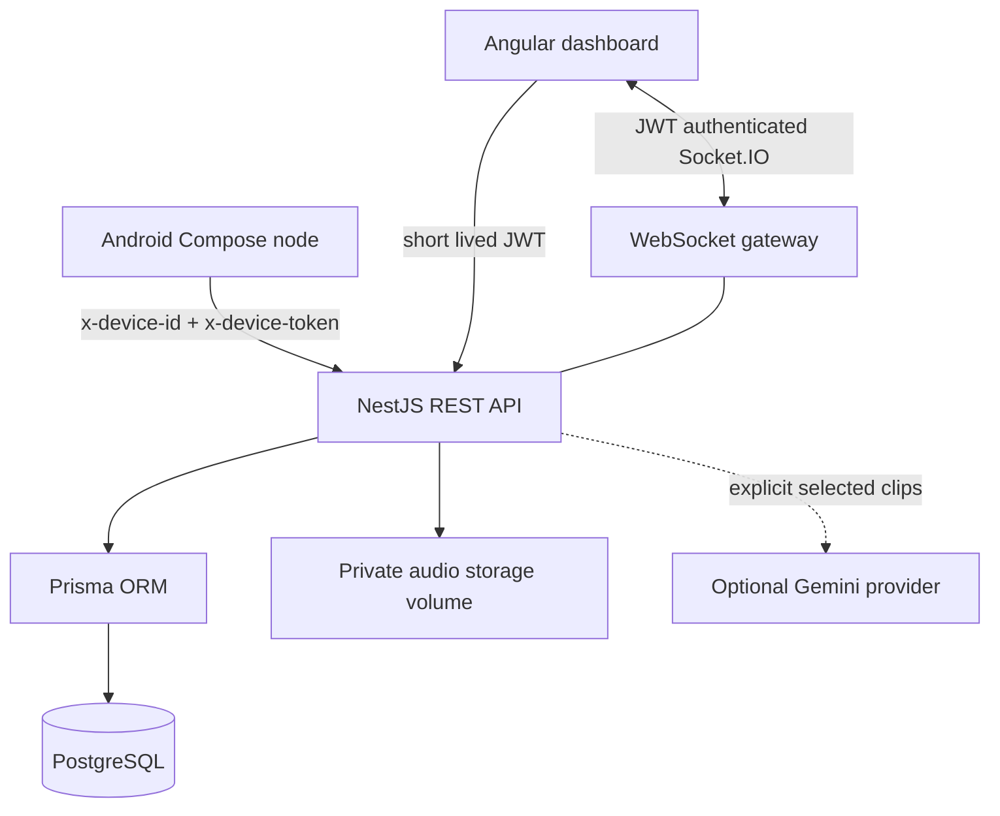

# Architecture

NestJS is the authority for identity, roles, device credentials, event status, and review history. Device secrets are returned once at provisioning and stored as bcrypt hashes. Human JWTs carry a user ID and role. The gateway checks the JWT at connect time. Audio must be stored outside the web root and served only after event authorization.

The backend includes device provisioning, separate device credentials, heartbeat history and stale-device detection, paginated event filtering/review, private audio transfer, alert acknowledgement, and optional asynchronous Gemini analysis. The Angular shell includes dashboard, event listing and protected event investigation/playback. Android microphone collection/offline synchronization, Leaflet map rendering and user administration remain incomplete; this is not a field-validated detector.
